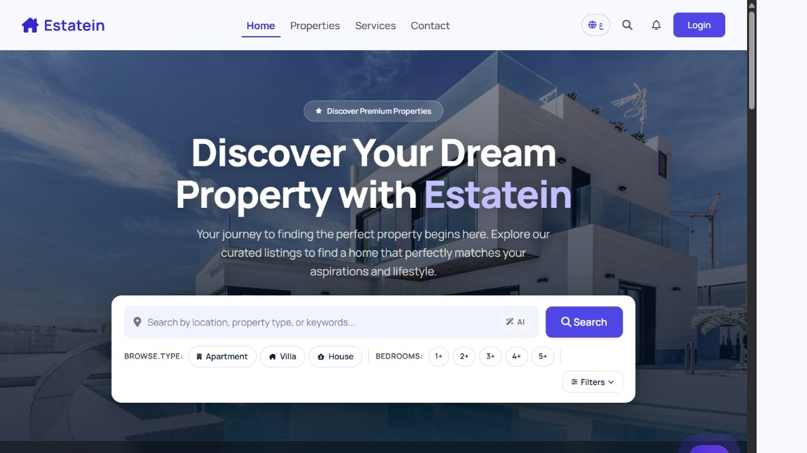
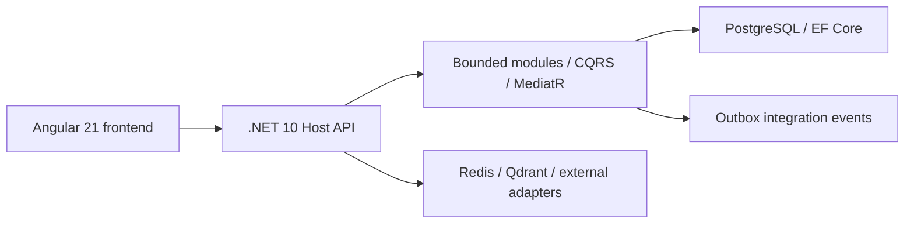

# Real Estate Management Platform

[](https://github.com/kandeel11/Real-Estate-ITI-Graduation-Project/actions/workflows/ci.yml)

ITI team graduation project covering properties, leases, maintenance, subscriptions, wallets, payments, documents and AI-assisted workflows.



[Public UI walkthrough](docs/DEMO.md) · [Original feature reference](docs/REFERENCE.md)

## Team and contribution

The repository contains the team's shared work. Ahmed Shebl's role: Backend Architect & Team Lead. A concrete contribution is [free-subscription backfill for seeded accounts](https://github.com/kandeel11/Real-Estate-ITI-Graduation-Project/commit/755788d601c52e0e6815a73fbf1cc6f83d322f5d), touching Host startup and property seeding. Additional authored work is visible in [Owner fixes PR #60](https://github.com/kandeel11/Real-Estate-ITI-Graduation-Project/pull/60).

## Architecture and current stack



The current module registrations use `UseNpgsql`; the backend database is PostgreSQL. The older reference document's SQL Server and frontend version descriptions are historical.

## Build from source

Requires .NET 10 SDK and Node.js 24 with npm. These commands build without starting production services:

```sh
dotnet build src/Host/RealEstate.Host/RealEstate.Host.csproj -c Release
cd frontend
npm ci
npm run build -- --configuration production
```

## Run locally

Provision a separate PostgreSQL development database, Redis and the configured Qdrant service. Supply `ConnectionStrings:DefaultConnection` and adapter settings through local configuration/user secrets. Review Host startup migrations/seeding and each integration configuration before starting the backend:

```sh
dotnet run --project src/Host/RealEstate.Host
```

Set `apiUrl` in `frontend/src/environments/environment.ts` to your local API (the checked-in Cloudflare quick-tunnel URL is temporary), then run `npm start` from `frontend`. Payment, email, media and AI flows need their respective development credentials. The public UI demo was captured with the API pointed at an unused localhost port; it does not demonstrate live property, payment or AI results.

## Verification status

The additive CI workflow builds the Host and production frontend; it does not deploy. On 11 October 2026 both builds passed locally, with existing backend warnings and frontend budget warnings. The existing Angular suite reported **28 passing / 43 failing tests** across 52 files, primarily missing dependency providers. Run `npm test -- --watch=false` to reproduce; these failures require a separate test-harness repair. Build success is not a claim that the complete test suite passes. The backend restore also reports an existing Newtonsoft.Json 11.0.2 dependency advisory that needs a dependency review.
